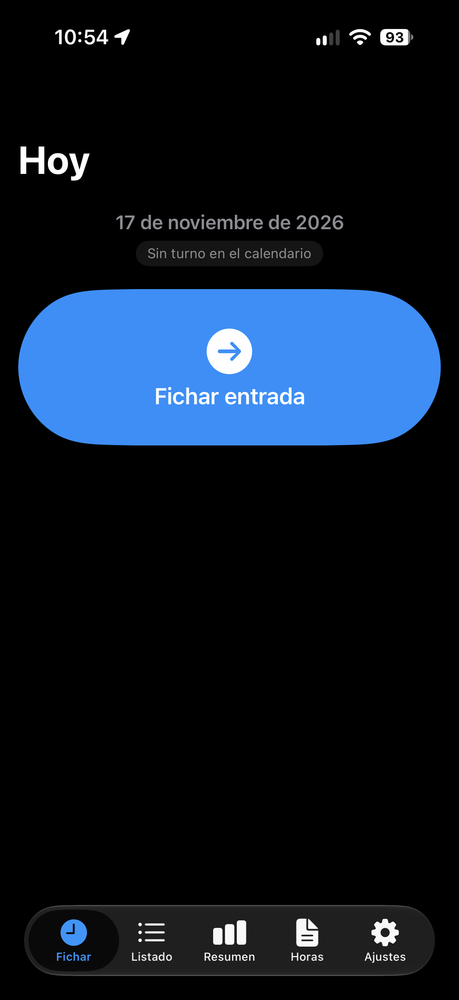
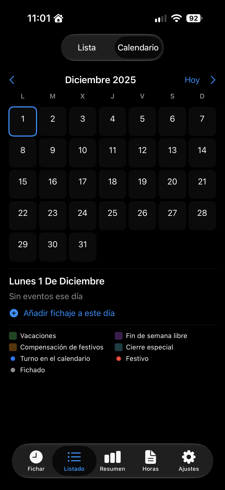
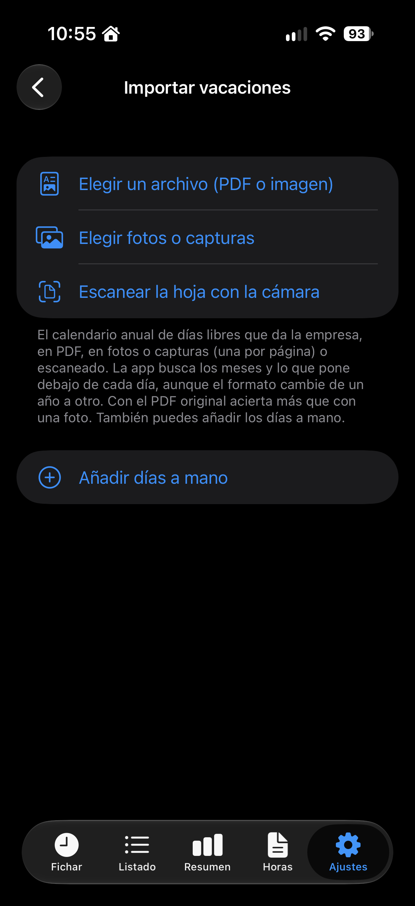
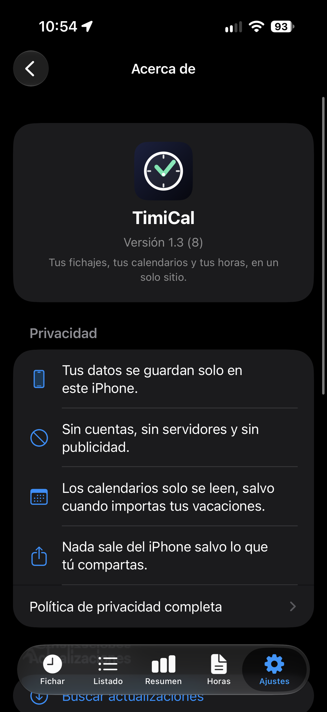

# TimiCal

  
  
  
  

App para iPhone para fichar entrada y salida en un toque, comparar tus horas
con las previstas en tu calendario de Trabajo, controlar vacaciones y días
libres, y sacar informes en PDF.

**Privacidad:** todo se guarda solo en tu iPhone. Sin cuentas, sin
servidores, sin publicidad. La política completa está dentro de la app
(Ajustes > Acerca de TimiCal > Política de privacidad).

## Capturas

<table>
  <tr>
    <td align="center"> Fichar</td>
    <td align="center"> Calendario</td>
    <td align="center"> Importar vacaciones</td>
    <td align="center"> Acerca de</td>
  </tr>
</table>

## Qué hace

- **Fichar** desde la app, Atajos, Siri o el botón de Acción.
- **Horas fichadas frente a las previstas** en tu calendario de Trabajo
  (Overtime), día a día, descontando los descansos.
- **Resumen** por mes, trimestre fiscal y año, con gráficas e **informe en PDF**.
- **Vacaciones y días libres**: lee el calendario de vacaciones de la
  empresa desde un PDF, una foto o escaneando la hoja con la cámara.
- **Festivos de tu localidad**, que se descargan y actualizan solos.
- **Avisos de descanso**: entre jornadas, jornada máxima y días seguidos.
- **Horas oficiales**: compara tus fichajes con las horas que te pagan.
- **Copia de seguridad**, exportar a CSV, bloqueo con Face ID e iconos a elegir.
- Diseño de iOS 26 (Liquid Glass), en modo claro y oscuro.

## Cómo instalarla (gratis)

TimiCal no está en el App Store. Se instala con **SideStore**, que es
gratuito y firma la app con tu propio Apple ID (puedes usar uno secundario).

1. Instala SideStore siguiendo su guía oficial (la primera vez necesitas un
   ordenador, solo una vez).
2. En SideStore: pestaña **Fuentes** > **+** > pega esta dirección:

   `https://raw.githubusercontent.com/timicalapp/TimiCal/main/fuente.json`

3. Abre la fuente TimiCal e instala la app.
4. Ábrela: un asistente te guía para elegir tus calendarios.

### Con otras herramientas (AirSign, Sideloadly…)

Si tu herramienta instala desde una dirección, usa esta. Siempre descarga
la última versión:

`https://github.com/timicalapp/TimiCal/releases/latest/download/TimiCal.ipa`

## Actualizaciones

Cuando haya una versión nueva, SideStore la mostrará en **Mis apps** y la
propia TimiCal te avisará. Pulsa **Actualizar** (con LocalDevVPN conectado).
**No borres la app para actualizar**: actualizar encima conserva tus datos;
borrarla los borra.

Recuerda que con un Apple ID gratuito las apps caducan a los 7 días si
SideStore no las renueva: ábrelo de vez en cuando o activa la renovación
automática.

## Aviso

TimiCal es una app independiente y gratuita. **No está relacionada,
patrocinada ni aprobada por ninguna empresa** ni por ningún sistema de
control horario. Se ofrece **tal cual, sin ninguna garantía**: los cálculos
son orientativos y lo que vale es lo que conste oficialmente en tu empresa.
Quien la instala y la usa lo hace **bajo su propia responsabilidad**. La app
no envía tus datos a ningún sitio.

## Sugerencias y errores

Desde la app: Ajustes > Acerca de TimiCal > Enviar una sugerencia /
Informar de un error. O escribe a timicalapp@gmail.com.

---

## Para publicar una versión nueva (mantenimiento)

1. En Xcode, sube la **Version** (1.5.2 → 1.5.3…) y el **Build** (+1) y
   saca el `.ipa`. La Version tiene que ser **la misma que la etiqueta**.
2. Aquí en GitHub: **Releases** > **Draft a new release**.
3. **Tag**: `v` + la versión, por ejemplo `v1.5.3` (Create new tag).
4. Título `TimiCal 1.5.3` y, en la descripción, las novedades en texto
   normal (salen en SideStore).
5. Arrastra el archivo, llamado `TimiCal.ipa`, y pulsa **Publish release**.

En un minuto `fuente.json` se actualiza solo (pestaña **Actions**) y
SideStore avisará a todos. La automatización comprueba que la versión de
dentro del `.ipa` coincide con la etiqueta: si no, no la añade y sale en
rojo con el motivo. Las Releases sin `.ipa` o borradas se quitan solas de
la fuente.

## Capturas e imágenes de SideStore (mantenimiento)

- **Capturas**: carpeta [`capturas`](capturas). Sin metadatos ni datos
  personales (nada de nombres ni horas reales).
- **Cabecera** de la fuente y de esta página: `imagenes/cabecera.png` (1500×500).
- **Noticia** de la fuente: `imagenes/noticia.png`.
